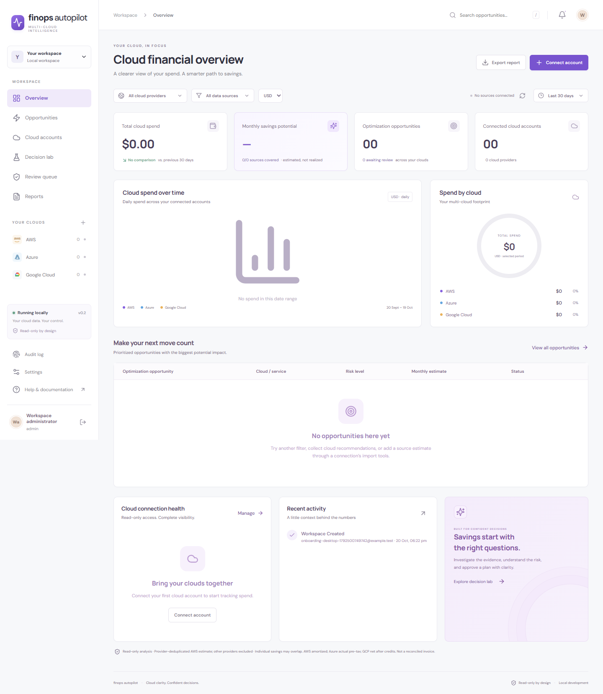
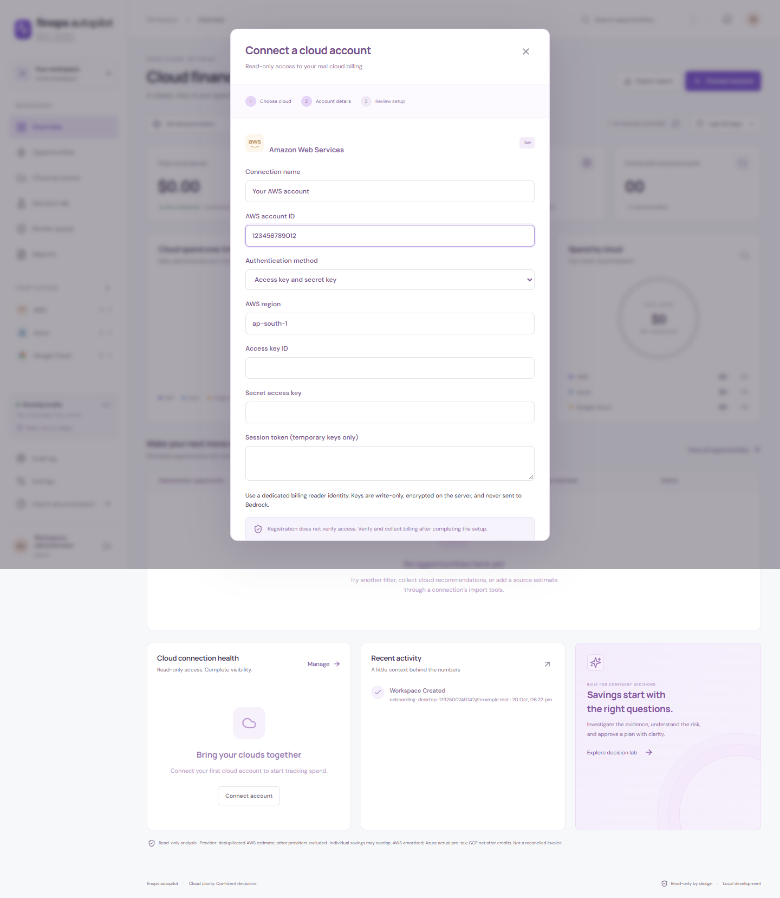
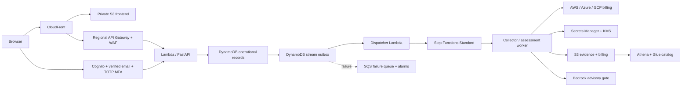

# FinOps Autopilot

Multi-client cloud cost visibility and evidence-based optimization planning for **AWS, Azure and Google Cloud**.

React + TypeScript · FastAPI · AWS CDK · DynamoDB · S3/Athena · Amazon Bedrock

New workspaces start empty. There is no demo sign-in, generated billing history or sample cloud-account option. Existing explicitly synthetic local records are removed during the local database migration; real workspaces are preserved. Test fixtures exist only in the isolated test suite.

## Application interface





The interface includes Overview, Opportunities, Cloud accounts, Decision lab, Review queue, Reports, Audit log and Settings. These images show empty onboarding states in an isolated documentation environment, without real account credentials or customer billing.

## Run locally

Use Windows, Python 3.12 and Node.js 24. The API binds to `127.0.0.1`; do not expose the local edition to a network.

```powershell
.\scripts\setup.ps1
.\scripts\start.ps1
```

Open **http://127.0.0.1:8000**, choose **Create a workspace**, then **Connect account**. Data persists under the ignored `data/` directory. The launcher enables real read-only cloud collection; it never starts a collection automatically. Set `$env:FINOPS_ENABLE_LIVE='false'` to disable live reads. `.env` files are not automatically loaded.

AWS supports both **IAM role + unique external ID** and **access key + secret key**, including a session token for temporary credentials. Keys are write-only and encrypted with Windows CurrentUser DPAPI locally, or Secrets Manager/KMS in AWS. Keys never enter browser storage, billing snapshots, application audit text or Bedrock prompts. Use a dedicated billing reader identity; the application cannot certify that supplied IAM credentials have no other permissions.

## Serverless deployment

The CDK application provisions separate retained data and application stacks in **Mumbai (`ap-south-1`)**:



Cloud sign-in uses Cognito authorization code + PKCE, verified email and required TOTP MFA. Tokens remain on the server; the browser receives an HttpOnly Secure session cookie. A new verified identity receives its own empty tenant, never another customer's records. Local passwords/sessions are not copied into Cognito.

```powershell
npm ci --prefix infra
.\scripts\package-lambda.ps1
npm run build
cd infra
npx cdk synth --strict
npx cdk diff
npx cdk deploy --all --strict
```

See [deployment and operations](docs/DEPLOYMENT.md) for prerequisites, outputs, recovery and accepted limitations. Deploying creates billable resources. Data resources use retention and deletion protection; destroying application code does not delete stored customer records.

## Provider coverage

| Capability | AWS | Azure | GCP |
|---|---|---|---|
| Connection | IAM role or access keys | Subscription + directory | Project + billing account + export |
| Billing | Cost Explorer amortized cost | Cost Management actual pre-tax | BigQuery standard export, net credits |
| Native recommendations | Cost Optimization Hub | Source import | Source import |
| Provider authentication | STS role or encrypted keys | Runtime federated identity / DefaultAzureCredential | Runtime ADC / workload identity federation |
| Resource mutations | None | None | None |

Azure and GCP live identity federation require customer/provider setup; the AWS deployment does not provision those identities. Billing CSV and source-recommendation imports work for all three providers. Real customer billing collection requires completing the onboarding and pressing **Verify & collect billing**. Pending registration is not verified access.

## Bedrock guidance

The selected configuration is **Claude Opus 5.5**, through Mumbai's **global inference profile**. Global inference can process data outside India. Every customer starts with AI disabled and India-only processing; only that customer's administrator can approve international processing. The deployment leaves the operator inference flag disabled until model access, a published guardrail, IAM routing restrictions and evaluation gates are configured.

AI suggests investigation steps from minimized evidence. It cannot replace source savings, clear policy gaps, approve a plan or execute cloud changes. Unknown telemetry stays unknown. [Bedrock setup](docs/BEDROCK_SETUP.md) and [India production controls](docs/BEDROCK_PRODUCTION_INDIA.md) explain the remaining enablement steps. No regulatory certification is implied.

## Project documentation

- [Project guide and API map](docs/PROJECT_GUIDE.md)
- [Dependencies and reproducible builds](docs/DEPENDENCIES.md)
- [Cloud account onboarding](docs/CONNECTORS.md)
- [Architecture and isolation](docs/ARCHITECTURE.md)
- [Deployment and operations](docs/DEPLOYMENT.md)
- [Validation results and release gates](docs/VALIDATION.md)
- [Planning cost estimate](docs/SERVERLESS_COST_ESTIMATE.md)
- [Security reporting](SECURITY.md)

## Validate

```powershell
.venv\Scripts\python.exe -m pip install -r requirements-dev.txt
.venv\Scripts\python.exe -m pytest -q
npm run build
npm --prefix apps/web run test:e2e
npm --prefix infra run test
```

Tests use isolated temporary databases and mocked provider responses. Browser fixture routes exist only in `tests/browser_server.py`, which is excluded from Lambda assets. Do not run that test server against real customer data. The public repository excludes credentials, databases, generated deployment outputs, the supplied private specification and local test artifacts.
