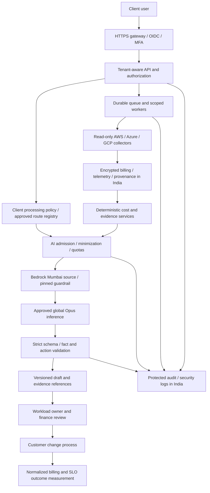

# Bedrock FinOps production and India customer plan

Decision record: 20 October 2026. Owner choice: Mumbai request endpoint, Claude Opus 5.5, and global inference only for clients whose authorized administrator explicitly approves international processing. This document is an implementation roadmap and control design. Customer compliance depends on applicable law, sector, contracts, operating evidence and competent review; an AI response or checkbox cannot certify it.

## Product outcome and current boundary

Use Bedrock to turn verified cost signals into understandable, reviewable work: explain evidence, identify what is missing, prioritize investigation and help workload owners assess tradeoffs. Keep financial calculations, source provenance, permission checks and change approval in deterministic services.

The local application implements that first advisory stage for AWS, Azure and GCP. It passes a small typed evidence bundle to the platform's AWS Bedrock endpoint; customers do not need an AWS workload to receive guidance. Native AWS recommendations are collected, while Azure Advisor and GCP Recommender still require their own production ingestion work. AI cannot compensate for missing native recommendations, telemetry or incomplete billing coverage.

| Available locally | Required for production |
|---|---|
| Tenant-scoped AI policy, admin role check and explicit global opt-in | Enterprise SSO/MFA, verified client authority, delegated administration and contract approval record |
| Scoped facts, fixed action catalog, pinned guardrail requirement and output validation | Guardrail deployment/evaluation, IAM-enforced restrictions, DLP tests and independently reviewed threat model |
| Idempotent jobs, quotas, current-context cache and rejection on changed context | Durable queue, leases, cancellation, distributed quotas, account-wide spend controls and reconciliation |
| Fact references, version metadata, usage and user feedback | Held-out quality evaluation, customer UAT, continuous drift monitoring and incident response |
| Human plan review; no resource mutation | Customer change-management integration and independent execution control, if execution is added later |
| SQLite evidence and local audit | Managed encrypted storage, protected audit archive, retention/deletion workflow and tested recovery |

Decider routing remains unconfigured. Bedrock guidance does not require inventing a Decider confidence score or treating a model opinion as an approval.

## Proposed production architecture

The diagram includes the broader production target. The CDK implementation now provides the Mumbai serverless baseline described in [DEPLOYMENT.md](DEPLOYMENT.md); Bedrock inference remains disabled until its separate enablement gates pass. Dedicated tenant isolation, automated retention/deletion, enterprise federation and sector-specific controls in this plan remain rollout work. See the deployment record for actual cloud status.

Put a central AI gateway behind server authorization. Resolve tenant membership from the authenticated session, never from a prompt, untrusted header or client-supplied identifier. Bind every job, cache entry, retrieval document, feedback item and audit event to that tenant. Include source revision, objective, full policy hash, model/guardrail/prompt/transfer versions and approval revision in cache validity. Use separate accounts or deployment boundaries for customers requiring stronger isolation.

Keep collection roles separate from inference roles. Prefer AWS scoped role assumption with unique external IDs, Azure delegated access/federated identity and GCP workload federation over customer keys. Resource execution, if later introduced, must be a separate service with narrow grants, two-person approval for material actions, canaries, rollback and a kill switch. The model must never gain permission merely because it recommends an action.

Deploy application storage, logs, secrets and backups in customer-approved Indian regions with customer-appropriate encryption/key access. Protect network ingress, restrict egress and use supported private endpoints where applicable. A private endpoint or Mumbai source **does not constrain global inference to India**. Enforce approved route/destination behavior through IAM/SCP and deployment boundaries. An application metadata lookup is useful evidence, but cannot replace cloud-level enforcement or guarantee a route cannot change between lookup and execution. See [AWS cross-region inference](https://docs.aws.amazon.com/bedrock/latest/userguide/cross-region-inference.html).

## Customer onboarding and India obligations

Make these decisions before enabling each customer's AI processing. Record the reviewer, evidence, effective date and renewal/review trigger in an approval ticket outside the local checkbox.

| Decision | Evidence to retain | AI policy consequence |
|---|---|---|
| Legal entity, industry, regulated activities and customer locations | Client intake and applicable obligations register | Select the relevant sector review; do not apply one template indiscriminately |
| Data categories and purpose | Field inventory, data-flow map and processing agreement | Exclude secrets, personal identifiers and unnecessary billing context |
| International processing | Customer contract, authorized legal/security approval and model/provider terms | Only approved clients select global processing; otherwise keep India-only and AI disabled |
| Roles and approvals | Verified administrator authority and workload/finance approvers | Least privilege and separation of duties |
| Retention and deletion | Schedule by raw billing, telemetry, drafts, audit, security logs and backups | Explicit lifecycle and legal-hold handling; no universal retention duration |
| Incident ownership | Platform/client contacts, escalation path and reporting playbook | Operate detection and regulatory/customer reporting clocks |
| Exit and access revocation | Export, credential revocation and deletion/retention evidence | Stop new inference promptly and preserve required records |

For personal data, map Data Fiduciary/Processor responsibilities, notices, purpose and lawful processing, rights handling, security and breach processes. The final **DPDP Rules 2025** have phased commencement: rule 4 after one year; rules 3, 5–16, 22 and 23 after eighteen months; other specified rules at publication. As of this guide's date, do not represent the entire ruleset as already effective. Track applicable Act commencement notifications, amendments and transfer restrictions with counsel. Administrator transfer approval is not automatically Data Principal consent. [Final Gazette, G.S.R. 846(E), rule 1](https://www.meity.gov.in/static/uploads/2025/11/53450e6e5dc0bfa85ebd78686cadad39.pdf).

For covered entities, implement the **CERT-In** reporting workflow: classify relevant Annexure I incidents and report within six hours of noticing/notification, designate a point of contact, maintain accurate synchronized clocks and securely retain relevant ICT logs for the prescribed rolling 180 days in Indian jurisdiction. Use the official FAQ to resolve scope and reporting details; an initial report need not wait for a complete investigation. Additional sector or contractual duties may differ. [CERT-In Directions](https://www.cert-in.org.in/PDF/CERT-In_Directions_70B_28.04.2022.pdf), [official FAQ](https://www.cert-in.org.in/PDF/FAQs_on_CyberSecurityDirections_May2022.pdf).

For regulated finance, assess applicability of the [RBI IT outsourcing directions](https://systemhealth.rbi.org.in/Scripts/BS_ViewMasDirections.aspx_id%3D12486%283%29.html), including vendor due diligence, contractual oversight, audit/access, cross-border risk, continuity and exit. Payment, securities, insurance, government and health customers need their own current regulator/contract review. Do not promise that an approval by a client administrator overrides a binding localization or outsourcing restriction. Where requirements prohibit this route, leave global Opus blocked and separately evaluate a permitted model/deployment.

These are review inputs, not an exhaustive legal opinion. Production acceptance requires the customer's designated legal, security and business owners to sign the obligations/control mapping and unresolved exceptions.

## Data protection and model governance

The implemented bundle contains provider/category enums, source estimate with currency, validated CPU/memory percentages or unknown, environment enum, boolean ownership/rollback/window/dependency flags, synthetic-data marker, deterministic policy outcome/gaps, a policy hash and an application-owned guidance catalog. It excludes raw titles, names, resource/account IDs, tags, credentials and arbitrary source text. No free-form chat prompt or cloud tool is exposed. Commercially sensitive metrics still leave the application when inference is requested.

Keep the boundary explicit:

1. Authenticate and authorize the analyst; verify the client's approved provider and international-processing policy.
2. Check current source revision, quota, operator settings and pinned guardrail. Inspect the route before sending evidence.
3. Minimize and validate the input; treat provider exports, uploaded documents and retrieved text as untrusted data.
4. Invoke the approved model with explicit output limits and no tools. Do not log SDK request bodies, raw responses or internal reasoning.
5. Reject blocked, truncated, malformed, unknown-reference or unsupported-action responses. Local validation also forbids narrative numbers, external URLs and selected unsafe claims. These checks reduce risk; they cannot establish semantic truth.
6. Recheck source, policy, approval and runtime versions before committing. Revocation during an in-flight request discards the result; it cannot recall data already transmitted or guarantee cancellation of charges.
7. Render escaped text and application-owned links/actions. Require a human to evaluate relevance, feasibility and workload safety.

Publish and test guardrails before client enablement. For production, assess [account/organization guardrail enforcement](https://docs.aws.amazon.com/bedrock/latest/userguide/guardrails-enforcements.html) so the runtime cannot bypass the configured protection. Check supported policy types; Automated Reasoning is not supported in enforced guardrail configurations documented there. Neither guardrails nor an LLM-as-judge is a regulatory compliance engine.

Review model/API-specific retention, abuse detection, service terms and invocation logging with each customer. Do not promise blanket zero retention across every Bedrock model and API. The current [retention documentation](https://docs.aws.amazon.com/bedrock/latest/userguide/data-retention.html) describes region/account controls and API-specific behavior; verify coverage for the actual Converse path and selected model before promising a retention commitment. Client-side absence of prompt logs does not establish provider-side zero retention. A model or retention-policy change requires a fresh risk review and may require renewed approval.

Audit metadata should include actor, tenant, request/job/generation IDs, processing-approval revision, source/policy hashes, prompt/transfer/model/guardrail versions, source region, possible destination set, outcome/rejection code, latency and token usage. Store only approved content needed for review. Add append-protected storage, restricted retrieval, retention controls and alerting for unauthorized reads. The local SQLite audit is not an immutable compliance archive.

If customer knowledge retrieval is added, first implement ingestion authorization, malware/secret checks, document provenance, per-tenant indexes or enforceable filters, deletion propagation and retrieval authorization tests. Retrieve only approved documents; filter by tenant before retrieval. Prompt text is never an access-control boundary. RAG is not implemented in this local release and is not necessary for its fixed-fact guidance workflow.

## Make the advice produce measurable value

Use an improvement loop with accountable owners and comparable financial data. These are proposed product stages; only the first-stage guidance is implemented today. This direction fits the [FinOps Foundation domains](https://www.finops.org/framework/domains/) of understanding usage/cost, quantifying business value, optimization and practice management.

| Stage | Bedrock contribution | Deterministic source and owner |
|---|---|---|
| Explain | Turn verified facts and gaps into an understandable investigation plan | Native recommendation, typed evidence and workload owner |
| Prioritize | Explain performance, operational and business tradeoffs | Risk policy, coverage, source estimate and service objectives |
| Validate | Summarize measured candidate-test results | Provider-backed candidate, benchmark and owner acceptance |
| Plan | Draft a change ticket with prerequisites and rollback questions | Approved maintenance window, tested rollback and human reviewer |
| Learn | Explain measured results and remaining uncertainty | Normalized post-change billing, workload demand and service health |

Add Azure Advisor/GCP Recommender and representative peak telemetry before presenting detailed cross-cloud optimization decisions. Gather at least criticality, owner, seasonal/business demand, SLOs and dependency context. Never infer safe deletion from an idle resource or purchase a commitment based on utilization alone.

For realized savings, create a baseline and measurement window, normalize for workload volume and pricing/commitment changes, exclude tax/FX differences or disclose them, reconcile overlap, then obtain finance review. Track cost per business unit and service-health regressions. Estimated savings, approved plans and realized savings must remain distinct. No model-generated estimate should enter the financial ledger.

Measure evidence completeness, time to a reviewed decision, accepted and implemented actions, verified realized benefit, cost per business unit, SLO regression, cost per useful AI draft, validation rejection rate, p50/p95 latency, quota failures, unsafe reports and reopened actions. User helpfulness ratings are feedback, not an accuracy score. Establish baseline and target values during a pilot rather than inventing savings or quality percentages now.

## Evaluation, release and operations gates

Use a versioned held-out evaluation set covering all providers, recommendation categories, India-only/global-approved tenants, fresh/stale/missing evidence, unusual billing credits/currencies, commitments, peak demand, malicious source text and multiple customer contexts. Include expert-labeled expected facts, allowed actions, unacceptable claims and expected abstentions. This follows a governed risk lifecycle such as [NIST AI RMF](https://www.nist.gov/itl/ai-risk-management-framework); it does not confer certification.

Require zero observed cross-tenant disclosure, unauthorized transfer, policy override or resource execution in the release test set, and treat any such finding as a release blocker. Passing a finite test set is not proof that such failures are impossible. Have FinOps engineers and workload owners assess factual support, action relevance and missing risks; calibrate acceptance thresholds before pilot release. Compare the pinned Opus configuration with the rule-only baseline using measured cost, latency and useful outcomes. Evaluate semantic quality separately from valid JSON.

| Gate | Acceptance evidence | Accountable owner |
|---|---|---|
| Customer processing | Signed obligations/transfer/retention review and verified administrator scope | Client legal/security + platform privacy owner |
| Identity/isolation | SSO/MFA, server authorization and adversarial tenant/role/cache/retrieval tests | Security engineering |
| Model route | Real entitled account, published guardrail, permitted IAM/SCP route and reviewed terms | AWS/platform owner |
| AI quality | Held-out expert evaluation, prompt-injection tests and customer UAT | FinOps + AI engineering |
| Reliability | Durable jobs, timeout/duplicate/crash tests, capacity test and agreed SLOs | Platform/SRE |
| Financial correctness | Native billing/recommendation reconciliation, coverage and overlap tests | FinOps/finance |
| Recovery | Encrypted backup restoration, recovery targets and failure runbooks exercised | SRE/security |
| Incident readiness | On-call ownership, clock/log verification, reporting drill and kill-switch test | Security incident lead |

Start with synthetic data, then one explicitly approved low-risk client with reviewed real evidence and human supervision. Roll out by client cohort behind the feature flag after gates pass. Avoid simultaneous model/prompt/guardrail changes; pin versions, compare to baseline, retain rollback configuration and obtain reapproval when the processing contract changes. Never silently fail over to a different geography.

Operate both a platform kill switch and client-level disable controls. Alert on unsafe feedback, unexpected destinations, rejection spikes, latency, unusual tokens, quota failures and stale source coverage. Define escalation and resolution owners; Unsafe feedback currently records a signal but does not automatically page an incident team. Reconcile invoiced AI spend and allocate it to customer usage. Local token admission is not a hard monetary budget; the production gateway needs fleet-wide concurrency, request-rate and spend controls in addition to AWS billing alerts.

## Prioritized implementation order

1. **Controlled local pilot:** finish AWS credentials/entitlement, publish/evaluate the guardrail, run preflight, record one client's international-processing review and execute a small supervised live smoke test. No real inference was verified in this delivery.
2. **Trusted data and identity:** implement enterprise authentication, delegated cloud onboarding, Azure/GCP native recommendation ingestion, full telemetry and financial reconciliation. Resolve customer-specific obligations before exporting real evidence.
3. **Production operations:** move to managed encrypted storage and durable workers, enforce isolation/route/guardrail policies, implement protected audit, retention, incident response, backups, capacity tests and staged deployment.
4. **Proven outcomes:** integrate customer change tickets and normalized post-change measurement, evaluate model usefulness and cost, and expand only after expert and customer acceptance. Consider richer retrieval or execution separately after their own security and quality gates.

Local configuration steps are in [BEDROCK_SETUP.md](BEDROCK_SETUP.md). The complete application backlog is in [ARCHITECTURE.md](ARCHITECTURE.md); actual test evidence and unverified capabilities are in [VALIDATION.md](VALIDATION.md).
